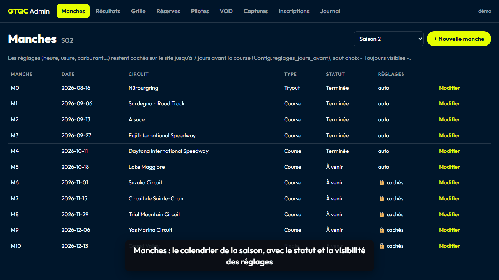
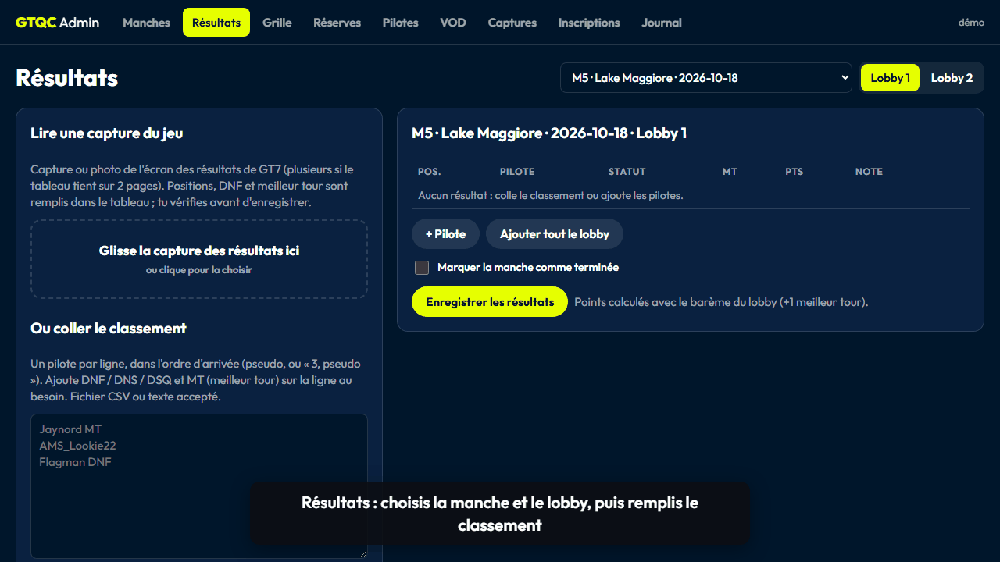
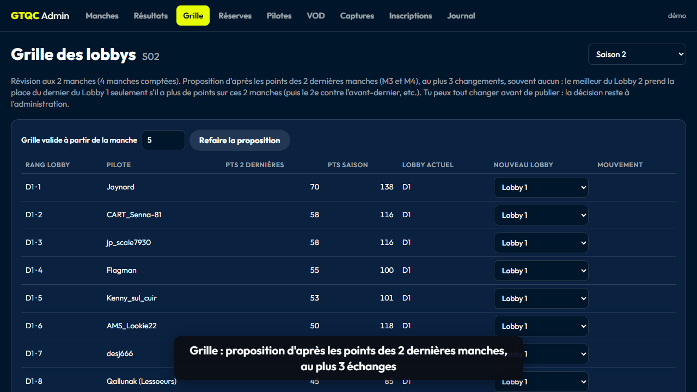
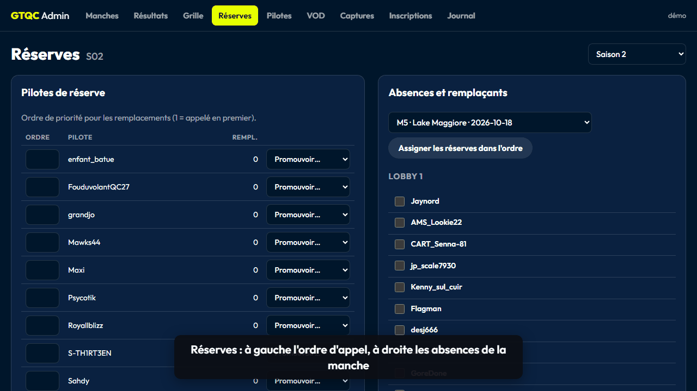
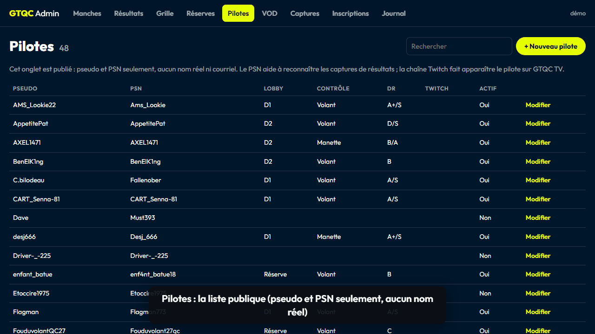
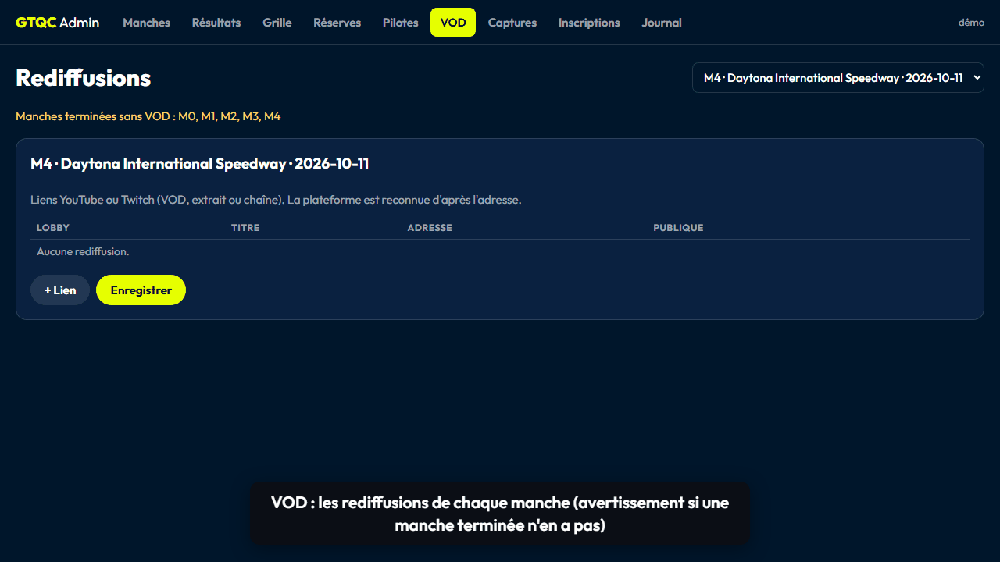
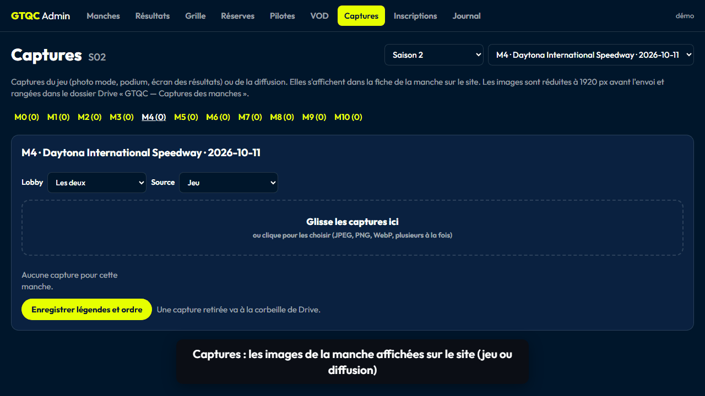
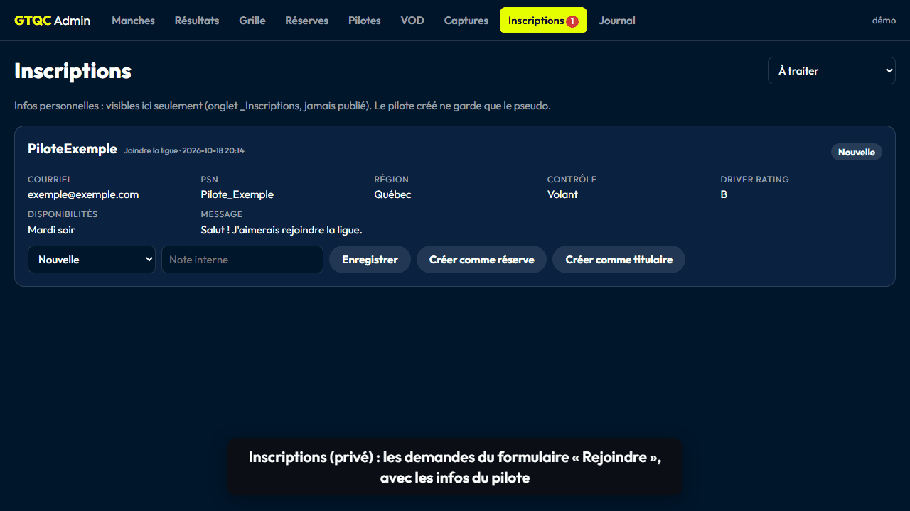
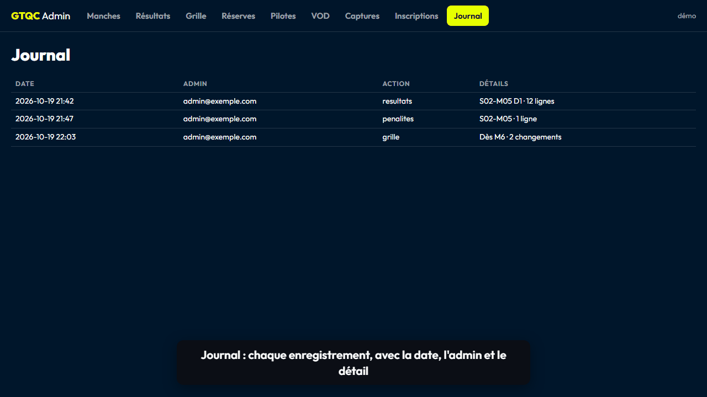

# Guide de l'admin GTQC

Une animation par onglet. Rien n'est enregistré tant que tu n'as pas cliqué sur le bouton **Enregistrer** de la section ; un message en bas de l'écran confirme ou explique l'échec.

Accès : ton courriel doit être dans l'onglet `_Admins` du classeur. Session expirée : recharge la page.

## Manches
Créer et modifier le calendrier. « + Nouvelle manche » reprend la dernière manche (2 semaines plus tard) : il reste à choisir le circuit. Les réglages restent cachés sur le site jusqu'à 7 jours avant la course (mode « Auto »).



## Résultats
Choisis la manche et le lobby, puis glisse la capture de GT7 ou colle le classement (un pilote par ligne, `MT`, `DNF`, `DNS`, `DSQ`). Vérifie, corrige l'ordre, puis enregistre. Les pénalités se saisissent en bas de l'onglet.



## Grille
Proposition des montées et descentes d'après les 2 dernières manches (au plus 3 échanges, souvent aucun). Change ce que tu veux, indique la manche de départ, puis publie.



## Réserves
À gauche : ordre d'appel des réserves et promotions. À droite : coche les absents de la manche, assigne les réserves dans l'ordre, enregistre.



## Pilotes
Liste publique : pseudos et PSN seulement, jamais de nom réel ni de courriel. « Modifier » ouvre la fiche (PSN, Twitch, rôle et lobby de la saison).



## VOD
« + Lien » par rediffusion : lobby, titre et adresse YouTube ou Twitch (`https://…`).



## Captures
Images de la manche affichées sur le site. Choisis le lobby et la source, glisse les images, ajoute une légende au besoin, enregistre.



## Inscriptions (privé)
Demandes du formulaire « Rejoindre ». Fais avancer le statut, ajoute une note interne, ou crée le pilote (réserve ou titulaire) : seul le pseudo passe dans la fiche publique. *Demande fictive dans l'animation.*



## Journal
Lecture seule : qui a enregistré quoi, et quand. *Entrées fictives dans l'animation.*



---

Les animations sont faites en mode démo local (rien n'est enregistré). Pour les refaire après un changement de l'admin :

```
python outils/guide_admin_gifs.py
```
